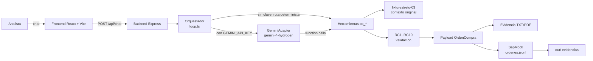

# Reto 03 — Agente conversacional de Órdenes de Compra SAP

**Demo pública (túnel, temporal):** <https://practice-lexmark-acre-define.trycloudflare.com>
**Repositorio público (código fuente):** <https://github.com/dfserver1/reto-03-sap-agent>
**Documento de solución:** [`SOLUCION.md`](./SOLUCION.md) · **Seguridad:** [`SECURITY.md`](./SECURITY.md)

[](https://nodejs.org)
[](./SOLUCION.md)
[](./tsconfig.json)

> **Estado del modelo en la URL pública:** la instancia de demostración se levantó sin `GEMINI_API_KEY`, por lo que el servidor usa el adaptador determinista (`/api/health` devuelve `provider: "mock"`). El adaptador Gemini está implementado y se activa definiendo `GEMINI_API_KEY`; el resto del flujo (herramientas, reglas, confirmaciones, evidencia y SAP simulado) es exactamente el mismo. Ver [“Activar Gemini”](#activar-gemini).

---

## 1. Qué hace el agente

Un analista recibe por correo un paquete de compra (correo, solicitud, cotización y aprobación) y hoy lo transcribe a mano a SAP. El agente recibe ese paquete como archivos del kit, lo **lee**, lo **valida** contra los maestros, construye el **payload** de la OC, genera la **evidencia** (`aprobacion.txt` / `.pdf`) y **crea la OC** solo cuando no hay excepciones. Si algo no cuadra, no resuelve solo: explica el problema y pide una **confirmación humana**.



**Implementación:** backend Express + TypeScript estricto, frontend React + Vite, Zod para el contrato de herramientas, hash canónico para impedir alteración del payload, y sesiones en memoria con confirmaciones separadas.

---

## 2. Resultado verificable

El demo determinista no consume LLM y recorre los seis casos del kit:

```bash
npm run demo
```

| Caso | Qué prueba | Resultado | OC / motivo |
|---|---|---|---|
| `sol-001` | Camino feliz | `apta=true`, sin bloqueos ni confirmaciones | `4500000001` |
| `sol-001` (2.ª vez) | Idempotencia | Devuelve la misma OC, no crea otra | `4500000001` |
| `sol-002` | Proveedor inexistente | `apta=false`, bloqueo `RC1` | No se crea |
| `sol-003` | Aprobador de otro centro de costo | `apta=false`, bloqueo `RC2` | No se crea |
| `sol-004` | Cotización 6 % mayor | `apta=true`, confirmación `RC5`; sin confirmar queda `PENDIENTE_CONFIRMACION` | `4500000002` tras confirmar |
| `sol-005` | Factura anterior a la solicitud | `apta=true`, confirmación `RC8`, `retroactiva=true` | `4500000003` |
| `sol-006` | Faltan IVA y condición de pago | `apta=true`, confirmación `RC6`; deriva IVA `C1` y pago `Z030` | `4500000004` |

**Resumen:** `6/6 PASS`, 4 OC creadas, 10 filas en `out/control.csv`, 4 órdenes en `out/sap/ordenes.jsonl`.

En `sol-004` se usa el valor de la **solicitud** (`25.000.000`), no el de la cotización (`26.500.000`); la diferencia queda como excepción `RC5` y el humano confirma. En `sol-005` la OC se crea marcada como retroactiva y se registra en el control.

---

## 3. Requisitos mínimos

| Requisito | Versión | Para qué |
|---|---|---|
| Node.js | **20+** (probado con Node 24) | Backend, build y demo |
| npm | Incluido con Node | Instalar dependencias |
| Navegador moderno | Últimas versiones | Interfaz de chat |
| Git | Opcional | Clonar desde el repositorio público |
| Docker Desktop | Opcional | Opción C — despliegue con Docker |
| `cloudflared` | Opcional | Opción E — túnel público temporal |
| Clave `GEMINI_API_KEY` | **Opcional** | Modo con Gemini real; sin ella corre en modo determinista |

> No requiere base de datos (los maestros son archivos JSON del kit y el SAP es simulado). La `out/` se regenera con `npm run demo`.

---

## 4. Cómo ejecutarlo — elige una opción

### Opción A — ZIP adjunto al correo (build precompilado)

El ZIP contiene el código fuente **y** el build (`dist/` + `public/`). Pero requiere **Node 20+** y una sola instalación de dependencias para arrancar:

```bash
# Windows (PowerShell)
Expand-Archive -LiteralPath .\reto-03-sap-agent.zip -DestinationPath . -Force
cd reto-03-sap-agent

# Linux/macOS
unzip reto-03-sap-agent.zip
cd reto-03-sap-agent

npm install
npm start        # http://localhost:3001
npm run demo     # verificación 6/6 (sin LLM, sin internet)
```

> Para validar solo el comportamiento funcional no hace falta npm, modelo ni red: `npm run demo` prueba los 6 casos y la idempotencia de `sol-001`.

### Opción B — Clonar el repositorio público y validar

Repositorio público: <https://github.com/dfserver1/reto-03-sap-agent>

```bash
git clone https://github.com/dfserver1/reto-03-sap-agent.git
cd reto-03-sap-agent
npm ci
npm run build   # compila frontend (public/) y backend (dist/)
npm start       # http://localhost:3001
npm run demo    # 6/6 PASS, sin consumir LLM
```

- El repositorio contiene el código fuente, los fixtures, `SOLUCION.md`, `SECURITY.md` y `README.md`.
- `dist/`, `public/` y `out/` se reconstituyen con `npm run build` y `npm run demo`; no se publican por ser artefactos.
- Para validar solo el comportamiento funcional, `npm run demo` no requiere red, modelo ni clave de API.
- Para validar sin instalar nada, usa el ZIP adjunto al correo (incluye el build precompilado `dist/` + `public/`).

### Opción C — Docker (un solo comando)

```bash
docker compose up --build
```

Abre <http://localhost:3001>. La primera vez compila el frontend y el backend. El volumen `reto03-out` conserva `out/`.

### Opción D — Local (arranque de desarrollo)

```bash
npm install
cp .env.example .env      # Windows: copy .env.example .env
npm run dev
```

- Frontend de desarrollo: <http://localhost:5173>
- API: <http://localhost:3001>
- Si no defines `GEMINI_API_KEY`, arranca en modo determinista y el chat sigue funcionando.

Para producción local:

```bash
npm run build
npm start
```

### Opción E — Túnel público (demo desde tu máquina)

```bash
# Terminal 1 (una sola vez: instalar y compilar)
npm install
npm run build
npm start

# Terminal 2
npm run tunnel
```

El script descarga `cloudflared` la primera vez en `.tools/` (ignorado por Git) e imprime una URL `https://....trycloudflare.com`. Mantén ambas ventanas abiertas. Para un despliegue permanente, usa el `Dockerfile`/`render.yaml` (sección 5).

---

## 5. Qué debe realizar y cómo se valida (para el reclutador)

**Objetivo:** verificar que el agente lee el paquete, aplica las reglas, genera evidencia y crea la OC únicamente cuando es seguro y confirmado.

**Matriz de validación rápida:**

| Qué validar | Comando / acción | Qué verás |
|---|---|---|
| Lógica funcional (6 casos) | `npm run demo` | `6/6 PASS`, 4 OC, idempotencia `4500000001` |
| Arranque UI + API | `npm start` | `http://localhost:3001` |
| Chat y tool calls | escribe `Procesa sol-004.` | Banner de confirmación RC5; `confirmo` → OC `4500000002` |
| `sol-001` idempotente | `Procesa sol-001.` dos veces | Misma OC `4500000001` |
| Bloqueos | `Procesa sol-002.` / `sol-003.` | RC1 / RC2, sin crear |
| Retroactiva | `Procesa sol-005.` | `retroactiva=true`, confirmación RC8 |
| Derivados | `Procesa sol-006.` | IVA `C1` + Pago `Z030`, confirmación RC6 |
| Estado del servidor | `GET /api/health` | `{"ok":true,"provider":"mock",...}` |

**Paso a paso (5 minutos):**

1. `npm ci`
2. `npm run demo` → confirma `6/6 PASS`.
3. `npm run build` → compila `public/` + `dist/`.
4. `npm start` → abre `http://localhost:3001`.
5. Prueba en el chat: `Procesa sol-001.` → `OC 4500000001`; `Procesa sol-004.` → pide confirmación; escribe `confirmo` → `OC 4500000002`.
6. Panel derecho: payload, evidencia (`aprobacion.txt`), `control.csv` y órdenes del SAP simulado.

---

## 6. Despliegue y estado público

- **ZIP adjunto:** build precompilado incluído; requiere Node 20+ y `npm install` (o `npm ci`).
- **Repositorio público:** fuente en GitHub; ver Opción B.
- **Docker:** `docker compose up --build`.
- **Render:** `render.yaml` define el servicio Docker con health check `/api/health` y `GEMINI_API_KEY` como secreto (`sync: false`).
- **Vercel:** `vercel.json` + `api/[...path].ts` (serverless, `/tmp/out`). En Windows, `vercel deploy --temporary` puede fallar con `spawn cmd.exe ENOENT`; usa el despliegue Git remoto o Docker/Render.
- **Túnel Cloudflare:** `npm run tunnel` (URL temporal `https://....trycloudflare.com`).

---

## 7. Variables de entorno

Copia `.env.example` a `.env`. **Ninguna clave se commitea**: `.env` está en `.gitignore`.

| Variable | Default | Uso |
|---|---|---|
| `LLM_PROVIDER` | `gemini` | `gemini` o `mock`. Si no hay clave, cae a `mock`. |
| `GEMINI_API_KEY` | — | Clave de Google AI Studio. Solo se lee del entorno; nunca se envía al front ni se escribe en logs. |
| `GEMINI_MODEL` | `auto` | Modelo de Gemini. `auto` lista los modelos disponibles y elige el mejor candidato; recomendado: `gemini-4-hydrogen`. |
| `GEMINI_MODEL_FALLBACKS` | lista en `src/llm/gemini.ts` | Cadena de modelos de fallback (por defecto: `gemini-4-hydrogen`, `gemini-3.8-flash`, `gemini-3.6-flash`, `gemini-3.5-flash-lite`, `gemini-2.5-flash-lite`). |
| `GEMINI_THINKING_LEVEL` | `low` | Nivel de pensamiento: `low`, `medium` o `high` (Gemini 4 Hydrogen admite `xhigh`). |
| `GEMINI_MAX_OUTPUT_TOKENS` | `2048` | Tope de salida (pensamiento + respuesta) por llamada al modelo. |
| `PORT` | `3001` | Puerto del backend. |
| `MAX_ITERACIONES_TOOL` | `25` | Tope de iteraciones del ciclo de herramientas. |
| `MAX_HERRAMIENTAS_POR_TURNO` | `12` | Tope de herramientas por turno; evita bucles multi-tool. |
| `MAX_TOKENS_SESION` | `60000` | Tope de tokens por sesión; al alcanzarlo el agente se detiene. |
| `MAX_TOKENS_SALIDA` | `2048` | Tope de tokens de salida por llamada al modelo. |
| `MAX_TOKENS_DIA` | `200000` | Presupuesto diario de tokens por proveedor. |
| `MAX_CONCURRENT_CHATS` | `4` | Concurrencia máxima de chats activos. |
| `OUT_DIR` | `out/` | Ruta de salida; en Vercel/serverless usar `/tmp/out`. En Vercel se usa `/tmp/out` automáticamente. |

### Activar Gemini

1. Crea una clave en Google AI Studio.
2. Agrégala al `.env` local:

   ```env
   GEMINI_API_KEY=tu_clave
   LLM_PROVIDER=gemini
   GEMINI_MODEL=gemini-4-hydrogen
   GEMINI_THINKING_LEVEL=low
   GEMINI_MAX_OUTPUT_TOKENS=2048
   ```

3. Reinicia el servidor (`npm start` o `docker compose up --build`).
4. Verifica `GET /api/health`: debe devolver `"provider": "gemini"`.

Si la clave falta o Gemini falla, el servidor no se cae: usa la ruta determinista y lo informa en la respuesta.

---

## 8. Cómo se usa el chat

1. Elige un caso en la barra lateral o escribe, por ejemplo, `Procesa la solicitud sol-001.`
2. El agente ejecuta y muestra cada llamada a herramienta (`oc_leer_paquete`, `oc_validar`, `oc_construir_payload`, `oc_generar_evidencia`, `oc_crear`) con sus argumentos y un resumen del resultado.
3. Si no hay excepciones, crea la OC y muestra el número, el payload y el enlace a la evidencia.
4. Si hay confirmaciones (`RC5`, `RC6`, `RC8`, `RC9`), aparece un banner rojo con el detalle. El agente **no crea** la OC hasta que respondas `confirmo` (o uses el botón **Confirmo y creo la OC**).
5. El panel derecho muestra el payload, la evidencia, el `control.csv` y las órdenes del SAP simulado.

Pruebas sugeridas para la defensa:

```text
Procesa sol-001.                 → OC creada
Procesa sol-002.                 → RC1, no se crea
Procesa sol-003.                 → RC2, no se crea
Procesa sol-004.                 → RC5, pide confirmación
confirmo                         → OC creada con valor de la solicitud
Procesa sol-005.                 → RC8, retroactiva, pide confirmación
Procesa sol-006.                 → RC6, propone C1, pide confirmación
```

La interfaz guarda el `sessionId` en `localStorage`; **Nueva sesión** limpia el historial de la conversación (no borra `out/`; para eso está `npm run clean`).

---

## 9. Estructura del repositorio

```text
reto-03-sap-agent/
├─ agent/
│  └─ prompt.md                 # System prompt del agente
├─ api/
│  └─ [...path].ts              # Entrada serverless opcional para Vercel
├─ fixtures/reto-03/            # Kit original (maestros + sol-001..sol-006), sin modificar
├─ modulo/
│  ├─ agent.md                  # Módulo portátil: prompt + frontmatter
│  ├─ skill/ordenes-compra/SKILL.md
│  └─ tools/oc.ts               # Re-export de las mismas herramientas
├─ src/
│  ├─ agent/loop.ts             # Ciclo del agente y ruta determinista
│  ├─ knowledge/ordenes-compra.md
│  ├─ lib/                      # Reglas RC1–RC10, normalización, payload, evidencia, auditoría, sesiones
│  ├─ llm/                      # Interfaz, GeminiAdapter, MockAdapter
│  ├─ sap/                      # SapAdapter + SapMock
│  ├─ tools/oc.ts               # Contrato Zod, herramientas y validación del payload
│  ├─ types/domain.ts
│  └─ server.ts                 # Express: /api/chat, /api/cases, /api/out/*
├─ web/                         # React + Vite (frontend)
├─ demo.ts                      # Verificación determinista de los 6 casos
├─ out/                         # Evidencia generada (no se versiona)
├─ Dockerfile
├─ docker-compose.yml
├─ render.yaml
└─ SOLUCION.md
```

---

## 10. Contrato de herramientas

Todas las herramientas devuelven **strings JSON** (`{ ok, data }` o `{ ok:false, error, codigo }`) y nunca lanzan excepciones al modelo. El backend valida los argumentos con Zod y devuelve el error de validación si no cumplen.

| Herramienta | Prioridad | Entrada | Salida |
|---|---|---|---|
| `oc_leer_paquete` | P0 | `{ caso }` | `{ correo, solicitud, cotizacion, aprobacion, factura?, faltantes? }`; un adjunto ausente se reporta como `null` y se lista en `faltantes`. |
| `oc_validar` | P0 | `{ caso, paquete }` | `{ apta, bloqueos, confirmaciones, derivados, retroactiva }`; el servidor relee el fixture y aplica RC1–RC10. |
| `oc_construir_payload` | P0 | `{ caso, paquete, derivados }` | `OrdenCompra` validado con Zod + `trazabilidad.json`. |
| `oc_generar_evidencia` | P0 (TXT) / P1 (PDF) | `{ caso, payload }` | `{ ruta, sha256, ruta_pdf? }`; `aprobacion.txt` y `aprobacion.pdf`. |
| `oc_crear` | P0 | `{ caso, payload, confirmado? }` | `{ numero_oc, fecha, idempotente, retroactiva }`; idempotente por `referencia.solicitud_id`. |
| `oc_leer_excel` | P1 opcional | — | No implementado; el kit entrega JSON/texto. |

El payload que recibe `oc_crear` se compara con el payload canónico reconstruido por el servidor (hash SHA-256). Si el modelo o un cliente altera un valor, la creación se rechaza con `PAYLOAD_ALTERADO`.

---

## 11. Salidas y despliegue

### Archivos de evidencia

```text
out/
├─ control.csv                  # Una fila por intento: CREADA, BLOQUEADA, PENDIENTE_CONFIRMACION, ERROR
├─ log.jsonl                    # Tool calls + auditoría
├─ sap/ordenes.jsonl            # Órdenes creadas en el SAP simulado
└─ <caso>/
   ├─ aprobacion.txt            # Evidencia P0
   ├─ aprobacion.pdf            # Evidencia P1
   └─ trazabilidad.json         # Payload + origen de cada campo
```

`out/` se limpia al inicio de `npm run demo` y **no se versiona**; el PRD excluye `out/` del ZIP de entrega. Para la demo pública, el servidor escribe en el `out/` local del proyecto (túnel) o en `/tmp/out` (Vercel/serverless).

### Docker / Render

- **Docker:** `docker compose up --build` (sección 4C).
- **Render:** el archivo `render.yaml` define un servicio Docker con health check y `GEMINI_API_KEY` como secreto (`sync: false`). Conéctalo a un repositorio y define la clave en el panel de Render.
- **Vercel:** existe `vercel.json` + `api/[...path].ts` como alternativa serverless. En Vercel el filesystem es efímero: la app escribe en `/tmp/out` y las sesiones viven en memoria por instancia. Para una demo con confirmaciones confiables, se recomienda Docker/Render o el túnel; Vercel sirve para una demo de una sola sesión si la instancia se mantiene caliente. En Windows, `vercel deploy --temporary` puede fallar con `spawn cmd.exe ENOENT` (limitación del CLI); en ese caso usa el despliegue remoto desde Git, WSL o Docker/Render.
- **Túnel:** `npm run tunnel` (sección 4E). Es la URL pública usada en esta entrega.

### Endpoints útiles

| Método | Ruta | Descripción |
|---|---|---|
| `GET` | `/api/health` | Estado, proveedor y modelo (sin claves). |
| `GET` | `/api/cases` | Resumen de los 6 casos. |
| `POST` | `/api/chat` | `{ sessionId?, message }` → respuesta, tool calls, `pending`, `tokensUsados`. |
| `GET` | `/api/sessions/:id` | Historial y tool calls de la sesión. |
| `GET` | `/api/out/control` | Filas de `control.csv`. |
| `GET` | `/api/out/sap` | Órdenes del SAP simulado. |
| `GET` | `/api/out/evidence/:caso` | Evidencia TXT/PDF del caso. |
| `GET` | `/api/out/trace/:caso` | `trazabilidad.json`. |

---

## 12. Seguridad y límites

- La clave del modelo solo se lee de `process.env`; no aparece en el frontend, el repositorio ni los logs. `/api/health` no la expone.
- Los fixtures se leen del disco y se validan en el servidor; el modelo no es la fuente de verdad de montos, NIT, fechas ni códigos.
- `oc_crear` reconstruye el payload esperado y compara hashes; cualquier alteración se rechaza.
- Las confirmaciones humanas se procesan en un turno separado: el modelo no puede pasar `confirmado=true` por sí mismo. La única ruta que lo hace es `manejarConfirmacionPendiente`, después de un mensaje afirmativo del usuario.
- Los topes de iteraciones, tokens y herramientas evitan bucles y consumo descontrolado:
  - `MAX_ITERACIONES_TOOL=25`, `MAX_HERRAMIENTAS_POR_TURNO=12` y `MAX_TOKENS_SESION=60000` en el orquestador.
  - Presupuesto diario de tokens por proveedor: `MAX_TOKENS_DIA=200000`.
  - Concurrencia máxima de chats: `MAX_CONCURRENT_CHATS=4`.
- Endurecimiento HTTP: Helmet con CSP estricta, `X-Frame-Options: DENY`, sin fuente inline de scripts, `Referrer-Policy: no-referrer`, COOP/COEP/CRP restringidos; rate limit global y por chat (120/12 req/min); body JSON máximo 256 kb; mensaje máximo 8000 caracteres; origen permitido para escrituras (`APP_ORIGINS`).
- Redacción centralizada: logs, errores, evidencias y respuestas se pasan por `src/lib/redact.ts` (secretos y variables con nombre sensible).
- No hay autenticación de usuarios ni persistencia de sesiones: es una demo. Para producción se requiere SSO, base de datos/Redis, rate limiting, trazas y un adaptador SAP real (ver `SOLUCION.md`).

---

## 13. Uso de IA

El detalle está en [`SOLUCION.md`](./SOLUCION.md), sección 11. En resumen: se usó un asistente de IA (OpenCode + DeepSeek V4.1 Flash) para scaffolding, adaptadores, UI, documentación y revisión; el modelo de producción es Gemini 4 Hydrogen (`gemini-4-hydrogen`) con `thinkingLevel` configurado. Todas las decisiones se verificaron con `npm run demo`, `npm run typecheck`, `npm run build`, pruebas de API y una prueba de interfaz en Chrome headless.

---

**Autor:** Omar — Reto técnico 03, Periferia IT Group.
